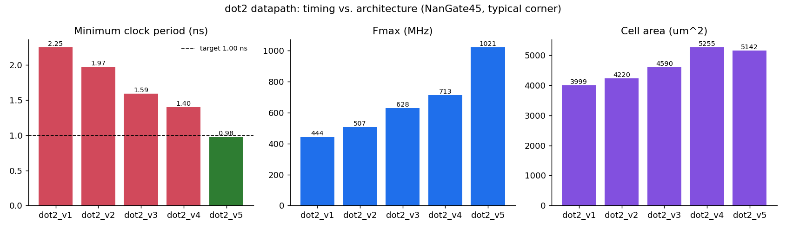

# RTL Design, Synthesis & Static Timing Analysis

[](https://github.com/Git-2001Abhishek/rtl-sta-timing-closure/actions/workflows/ci.yml)

## Overview

Designed and verified a pipelined arithmetic datapath in SystemVerilog
and evaluated its timing characteristics through RTL synthesis and
static timing analysis.

The datapath is a 16-bit two-term dot product,

```text
y = a*b + c*d          a, b, c, d: 16-bit unsigned,  y: 33-bit
```

implemented in five versions. Each one is an RTL change aimed at the
critical path reported by STA for the version before it. The target is
**1 GHz** in the NanGate 45 nm open cell library (typical corner). Every
version also gets a hold-fix ECO and is signed off at the slow, typical
and fast corners.

## Flow

SystemVerilog RTL → Simulation → Synthesis (Yosys) → Hold fix → Multi-corner STA → Critical Path Analysis → RTL Optimization

```text
rtl/*.sv ──► Icarus Verilog (tb_dot2: RTL sim, 5 versions in parallel)
   │
   ▼
Yosys      synth -flatten -noabc → dfflibmap → abc -D 1000 -liberty (typical)
   │                                     (scripts/synth.ys, scripts/run_flow.py)
   ▼
Hold ECO   insert delay buffers until hold slack ≥ 10 ps at the FAST corner
   │                                     (scripts/hold_fix.py)
   ├──► final netlists ──► Icarus Verilog (same testbench, -DGLS)
   ▼
STA        slow / typical / fast  ×  constraints/dot2.sdc
           scripts/sta.py  (+ scripts/sta.tcl: OpenSTA cross-check in CI)
   │
   ▼
reports/   setup / hold paths per corner, WNS / TNS, Fmax, area, summary
```

## Features

- Synthesizable SystemVerilog RTL
- Pipelined arithmetic datapath
- SDC timing constraints
- RTL synthesis using Yosys
- Static timing analysis: NLDM timing engine written for this project
  ([`scripts/sta.py`](scripts/sta.py)), unit-tested, plus an OpenSTA
  cross-check that runs in CI
- Critical-path identification
- Setup/hold analysis at three PVT corners (slow / typical / fast)
- Hold-fix ECO (delay-buffer insertion) at the fast corner
- Timing optimization through RTL modification
- Gate-level simulation of every final (post-ECO) netlist
- Continuous integration (GitHub Actions)

## Design versions

| Version | Latency | Change | Why |
| --- | --- | --- | --- |
| [`dot2_v1`](rtl/dot2_v1.sv) | 2 | Baseline: input regs → `a*b + c*d` → output reg | Reference point |
| [`dot2_v2`](rtl/dot2_v2.sv) | 3 | Register the products, add in the next stage | v1 critical path = multiplier **plus** 32-bit adder |
| [`dot2_v3`](rtl/dot2_v3.sv) | 4 | Split each multiply into two 16×8 partial products, recombine in a separate stage | v2 critical path = full 16×16 multiplier array |
| [`dot2_v4`](rtl/dot2_v4.sv) | 5 | Four 16×4 partial products per product, adder tree with a register at every level | v3 critical path = 16×8 array |
| [`dot2_v5`](rtl/dot2_v5.sv) | 4 | All 32 partial-product rows of **both** products in one Wallace-style 3:2 carry-save tree, pipelined in the middle, then one [Kogge-Stone](rtl/ks_adder.sv) prefix adder | v1–v4 all end in ripple-carry chains, so extra pipelining gave diminishing returns |

Every version has the same ports (`clk`, `rst_n`, `in_valid`, `a`..`d`,
`out_valid`, `y`). Only the valid pipeline has a reset; datapath flops
don't need one.

## Constraints

[`constraints/dot2.sdc`](constraints/dot2.sdc): 1.0 ns clock, 50 ps clock
uncertainty, 20 ps clock / input transition, 0.2 ns input and output
delays, 2 fF output load, `rst_n` false-pathed. Wire-load model
`5K_hvratio_1_1`.

| Corner | Process | Voltage | Temperature | Used for |
| --- | --- | --- | --- | --- |
| slow | SS | 0.95 V | 125 °C | worst-case setup |
| typical | TT | 1.10 V | 25 °C | synthesis target, main setup analysis |
| fast | FF | 1.25 V | 0 °C | hold (and hold fixing) |

## Timing Analysis

The initial implementation is analyzed to identify critical paths
and timing violations. RTL modifications are subsequently evaluated
through synthesis and STA to measure their impact on timing.

### What the critical paths showed

- **v1**: `b_q_reg → y_reg`, 36 gates, 2.17 ns. The path runs through the
  multiplier array and then all the way up the ripple carry of the
  final 33-bit adder.
- **v2**: removing the adder from the stage helps less than expected
  (1.89 ns). The 16×16 array itself is a long ripple structure.
- **v3 / v4**: halving the array height twice brings it down to 1.51 ns, then
  1.32 ns, but the gains shrink. Every partial product still ends in a
  carry-propagate chain (29 gates in both), and v4 needs 5 cycles of latency
  and 4.2× the flops of v1.
- **v5**: carry-save levels have a constant depth (one full adder) no matter
  how wide the operands are. So the design reduces all rows to two with no
  carry propagation at all, and resolves the carry once, in a log-depth
  prefix adder. The critical path is now 16 gates (0.894 ns) inside
  the final-adder stage, with **+20 ps slack at 1 GHz**, at the same
  4-cycle latency as v3.

### Synthesis finding: generic ABC destroys the prefix tree

With the default `synth` script, v5 only reached 883 MHz (5 violating
endpoints). The report showed the Kogge-Stone stage as a ripple-like chain
of AOI/OAI gates. Yosys' generic pre-mapping ABC pass optimizes for area
and had restructured the parallel-prefix carry network. Running
`synth -noabc` leaves all mapping to the single timing-driven
`abc -D 1000 -liberty` run, which keeps the structure, and v5 then closes
timing. The flow now uses `-noabc` for every version. The advantage holds
at the slow corner too: 297 vs. 257 MHz. The full default-flow numbers are in
[`reports/summary_default_synth.md`](reports/summary_default_synth.md).

### Multi-corner finding: hold violations only show up at the fast corner

At the typical corner every version met hold. At the fast corner,
**v3, v4 and v5 violated hold by 3 ps**. The failing paths were
register-to-register connections with no logic in between, for example
`s_q[0..3] → y[0..3]` in v5: the low bits of the carry row are always 0,
so the sum bits pass straight through the final adder. The delay at
1.25 V / 0 °C is shorter than hold time + 50 ps uncertainty.

[`scripts/hold_fix.py`](scripts/hold_fix.py) does what a P&R tool's hold
repair does. It re-times the netlist at the fast corner and inserts a
`BUF_X1` in front of every flop pin whose hold slack is below the 10 ps margin,
repeating until none are left ([`reports/hold_fix.log`](reports/hold_fix.log)).
v5 needs 11 buffers, v4 needs 74 (many shifted partial-product bits pass
straight through). Setup is unaffected, because the buffered pins all have
large setup slack.

## Results

From [`reports/summary.md`](reports/summary.md), final (post-ECO) netlists.

**Setup at the typical corner (1.000 ns target)**

| Design | Latency | Cells | Flops | Area (µm²) | Setup slack (ns) | TNS (ns) | Setup viol. | Min period (ns) | Fmax (MHz) |
| --- | --- | --- | --- | --- | --- | --- | --- | --- | --- |
| dot2_v1 | 2 | 3277 | 99 | 4000.1 | -1.251 | -20.926 | 29 / 133 | 2.251 | 444 |
| dot2_v2 | 3 | 3255 | 164 | 4221.7 | -0.974 | -28.495 | 63 / 198 | 1.974 | 507 |
| dot2_v3 | 4 | 3332 | 261 | 4620.7 | -0.592 | -22.731 | 87 / 295 | 1.592 | 628 |
| dot2_v4 | 5 | 3432 | 422 | 5314.1 | -0.402 | -17.844 | 102 / 456 | 1.402 | 713 |
| **dot2_v5** | **4** | 3596 | 334 | 5150.8 | **+0.020** | **0.000** | **0 / 368** | **0.980** | **1021** |

**All corners**

| Design | Fmax slow (MHz) | Fmax typ (MHz) | Fmax fast (MHz) | Hold slack slow / typ / fast (ns) | Hold buffers |
| --- | --- | --- | --- | --- | --- |
| dot2_v1 | 124 | 444 | 789 | +0.123 / +0.059 / +0.015 | 1 |
| dot2_v2 | 144 | 507 | 886 | +0.123 / +0.053 / +0.011 | 2 |
| dot2_v3 | 180 | 628 | 1076 | +0.123 / +0.053 / +0.011 | 38 |
| dot2_v4 | 207 | 713 | 1213 | +0.123 / +0.053 / +0.011 | 74 |
| **dot2_v5** | **297** | **1021** | **1733** | +0.123 / +0.053 / +0.011 | 11 |



- **2.3× Fmax** from v1 to v5 at the typical corner (444 → 1021 MHz), and
  **2.4×** at the slow corner (124 → 297 MHz), for +29 % area.
- v5 is faster than v4 with **one cycle less latency** and fewer flops:
  architecture beat brute-force pipelining.
- **1 GHz is a typical-corner result.** At the slow corner (0.95 V,
  125 °C) the NanGate45 cells are about 3.4× slower and v5 runs at
  297 MHz. Signing off 1 GHz at the worst-case corner would need a
  re-synthesis targeting the slow library and deeper pipelining.
- Hold is met at all three corners with at least 11 ps margin after the ECO.

Excerpt of the v5 critical path, typical corner ([full report](reports/dot2_v5_timing_typ.rpt)):

```text
Startpoint: s_q_reg[5]/CK (DFF_X1)
Endpoint:   y_reg[31]/D (DFF_X1)
 Load(fF)      Slew    Delay     Time   Description
     8.80     0.023    0.108    0.108 ^ s_q_reg[5]/Q (DFF_X1)
     6.32     0.043    0.073    0.181 ^ g311/Z (XOR2_X1)        propagate
     3.99     0.017    0.070    0.251 ^ g314/ZN (AND4_X1)       group P
      ...       ...      ...      ...   AOI211 / OAI211 prefix network
     1.45     0.014    0.040    0.894 v g483/ZN (XNOR2_X1)      sum[31]
                                0.894   data arrival time
                      -0.050    0.950   clock uncertainty
                      -0.036    0.914   library setup time
                                0.020   slack (MET)
```

### Verification

- **RTL** ([`results/sim.log`](results/sim.log)): all five versions run
  side by side against a cycle-accurate reference model. The stimulus is
  corner values (0, 1, all-ones, alternating bits) plus 5000 random vectors
  with random `in_valid` bubbles and a reset in the middle of traffic.
  **TEST PASSED**, about 3,775 results checked per version.
- **Gate-level** ([`results/gls.log`](results/gls.log)): the same
  testbench on the five final NanGate45 netlists, including the hold-fix
  buffers (zero-delay cell models generated from the Liberty `function`s by
  [`scripts/lib2v.py`](scripts/lib2v.py)). **TEST PASSED**.
- Mutation check: breaking the recombine shift in v3 makes the RTL run fail
  on nearly every vector.

### About the STA engine

OpenSTA isn't available on the Windows machine this was developed on, so
the numbers above come from [`scripts/sta.py`](scripts/sta.py), a compact
static timing analyzer written for this project. It does the same
analysis OpenSTA does for a single-clock design in wire-load mode:

- reads the Liberty NLDM tables, the Yosys JSON netlist and the SDC
- propagates rise/fall arrival times and slews through unate arcs using
  bilinear table lookup (input slew × output load)
- net load = pin capacitance + wire-load-model capacitance + `set_load`
- setup and hold checks on flip-flop D pins (Liberty constraint tables) and
  output ports
- prints OpenSTA-style path reports, WNS / TNS and Fmax

Limitations: ideal clock network, no recovery/removal checks on async
reset, no wire RC delay, no CRPR or OCV.

How it is validated:

- **Unit tests** ([`tests/test_sta.py`](tests/test_sta.py), `make test`,
  7 tests). A small hand-written Liberty library with different rise and
  fall delays checks bilinear interpolation and extrapolation, rise/fall
  propagation through negative-unate cells, setup and hold slack, net load,
  path tracing and SDC parsing, all against hand-computed values. One more
  test checks a real NanGate45 arc (`DFF_X1` CK→Q at 49.9 fF / 20 ps:
  0.2057 ns by hand).
- **OpenSTA cross-check in CI**. The `opensta` job of
  [the CI workflow](.github/workflows/ci.yml) runs
  [`scripts/sta.tcl`](scripts/sta.tcl) on the committed netlists in the
  `openroad/orfs` Docker image (OpenROAD embeds OpenSTA), with the same
  library, wire-load model and SDC.
  [`scripts/compare_opensta.py`](scripts/compare_opensta.py) puts the two
  results side by side and flags any difference above 50 ps:

  | Design | Setup slack sta.py | Setup slack OpenSTA | Diff | Hold slack sta.py | Hold slack OpenSTA |
  | --- | --- | --- | --- | --- | --- |
  | dot2_v1 | -1.251 | -1.228 | 23 ps | +0.059 | +0.059 |
  | dot2_v2 | -0.974 | -0.947 | 27 ps | +0.053 | +0.052 |
  | dot2_v3 | -0.592 | -0.572 | 20 ps | +0.053 | +0.052 |
  | dot2_v4 | -0.402 | -0.388 | 14 ps | +0.053 | +0.052 |
  | dot2_v5 | **+0.020** | **+0.034** | 14 ps | +0.053 | +0.052 |

  The two tools agree to within **27 ps** on every design, and OpenSTA also
  has v5 meeting 1 GHz. `sta.py` is consistently a little pessimistic on
  setup (14–27 ps), most likely because it keeps the worst slew at each
  node and OpenSTA doesn't.

## How to run

Requirements: Python 3 (+ matplotlib for the chart, pytest for the
tests), Icarus Verilog 12+, and Yosys. Any Yosys works, including the
pip-installable `yowasp-yosys`.

```bash
make lib          # download NanGate45 slow / typ / fast libraries (OpenSTA repo)
make test         # STA engine unit tests
make sim          # RTL simulation
make flow         # synthesis + hold fix + multi-corner STA -> reports/, results/
make gls          # gate-level simulation of the final netlists
make lint         # Verilator -Wall lint (all versions clean)
make opensta      # optional: OpenSTA cross-check (needs OpenSTA / OpenROAD)
```

All of the above runs in GitHub Actions on every push
([`.github/workflows/ci.yml`](.github/workflows/ci.yml)). CI synthesizes
with the pinned `yowasp-yosys` 0.70 release used for the committed results
and checks that the summary and netlists come out **byte-identical**. A newer
development build of Yosys (0.70+157) wrote netlists with undriven outputs
for this flow; the pin, an undriven-output check in `run_flow.py` and
gate-level simulation in CI all guard against that.

With `yowasp-yosys` instead of a native Yosys:

```bash
pip install yowasp-yosys==0.70.0.0.post1259   # version used for the committed results
make flow YOSYS=yowasp-yosys
```

Other target periods: `python scripts/run_flow.py --period 1.25`.

## Tools

- SystemVerilog
- Yosys
- Python STA engine (`scripts/sta.py`), OpenSTA / OpenROAD (CI cross-check)
- pytest, GitHub Actions
- Icarus Verilog
- Verilator (lint)
- GTKWave

## Repository Structure

```text
rtl/          - RTL source (dot2_v1 .. dot2_v5, ks_adder)
tb/           - Testbench (RTL and gate-level)
constraints/  - SDC constraints
scripts/      - Synthesis, hold fix, STA, flow and helper scripts
tests/        - Unit tests for the STA engine
reports/      - Timing reports per corner, area, hold-fix log, summaries
results/      - Final netlists, simulation logs, figures
liberty/      - Liberty files (downloaded, not committed)
.github/      - CI workflow (flow + OpenSTA cross-check)
```
